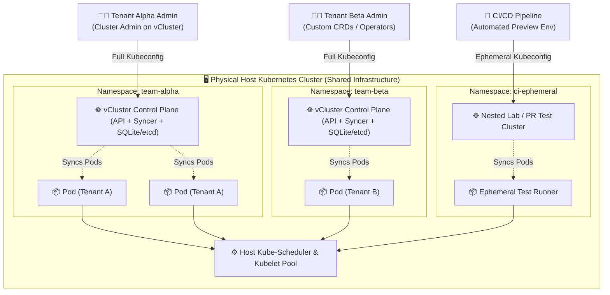

  

<h1 align="center">☸️ Awesome Virtual Kubernetes Clusters 🚀</h1>

  <strong>Curated ecosystem of SaaS platforms, open-source engines, nested control planes, and multi-tenancy frameworks for Virtual Kubernetes Clusters, KaaS, and Internal Developer Platforms (IDP).</strong>

  
  
  
  
  
  

---

## 📌 Executive Summary & Architecture Overview

**Virtual Kubernetes Clusters** (such as **vCluster**, **Kamaji**, and **k3k**) enable platform engineering teams to spin up fully functional, nested Kubernetes control planes inside a namespace on a shared host cluster. Each virtual cluster gets its own dedicated API server, Custom Resource Definitions (CRDs), storage abstractions, and RBAC permissions—while sharing underlying worker nodes, kernel resources, and physical networking.

This pattern overcomes the limitations of standard Kubernetes namespace isolation (where cluster-scoped resources like CRDs, ClusterRoles, and webhooks conflict) and avoids the astronomical cloud costs, slow provisioning times, and maintenance overhead of provisioning separate physical clusters for every developer, feature branch, or tenant.

---

## 📑 Table of Contents

- [📌 Executive Summary & Architecture Overview](#-executive-summary--architecture-overview)
- [📊 Sector Overview & Market Dynamics](#-sector-overview--market-dynamics)
- [🏢 SaaS & Hosted Commercial Platforms](#-saas--hosted-commercial-platforms)
- [💻 Open-Source GitHub Projects](#-open-source-github-projects)
- [⚖️ Architecture Comparison: Namespaces vs. Virtual Clusters vs. Physical Clusters](#️-architecture-comparison-namespaces-vs-virtual-clusters-vs-physical-clusters)
- [🤝 How to Contribute](#-how-to-contribute)
- [📈 Star History](#-star-history)
- [💖 Support & Community](#-support--community)
- [📜 Disclaimer](#-disclaimer)

---

## 📊 Sector Overview & Market Dynamics

The global cloud-native container management and Kubernetes orchestration market was valued at **$3.1 billion in 2023** and is projected to expand to **$11.8 billion by 2030** (growing at a compound annual growth rate of **~21.5%**). Within this domain, virtual clustering, nested control planes, and multi-tenancy software constitute the fastest-accelerating micro-segment, driven by massive enterprise demand for internal developer platforms (IDP), ephemeral CI/CD environments, and cloud FinOps infrastructure consolidation.

The market displays a **moderately fragmented and layered structure**: underlying physical cluster control planes are heavily concentrated among hyperscaler cloud titans (Microsoft Azure AKS, Alphabet Google GKE, and Amazon AWS EKS), whereas the specialized virtual cluster management, multi-tenancy governance, and nested control plane layer remains an innovative, highly competitive frontier populated by high-growth venture-backed platforms (such as Loft Labs, Spectro Cloud, and Clastix) alongside vibrant CNCF open-source ecosystems.

---

## 🏢 SaaS & Hosted Commercial Platforms

Below is a curated evaluation of leading commercial cloud providers and managed Kubernetes-as-a-Service (KaaS) management planes supporting multi-cluster governance, nested isolation, and virtualized workloads.

> *Sorted descending by company size (Valuation / Market Cap & Revenue).*

| Platform | Company Size (Valuation / Revenue) | Overview & Multi-Tenancy Capabilities | Pricing (Specific Starting Tier) | Free Tier Limits & Trial Period |
| :--- | :--- | :--- | :--- | :--- |
| **[Microsoft Azure AKS](https://azure.microsoft.com/en-us/products/kubernetes-service/)** | **~$3.1 Trillion** Market Cap • **~$245B** Annual Revenue *(Intelligent Cloud ~$100B+)* | Enterprise managed Kubernetes service featuring AKS Automatic, fleet manager, cluster-isolated control planes, Entra ID integration, and support for running nested vCluster workloads on Azure VMs. | **$0.10/hour per cluster** (~$73/month) for Standard cluster management with 99.95% uptime SLA; Free management tier available with VM worker nodes from **$0.0416/hour** (B2s instances). | **Free forever cluster management** on standard clusters (pay only for compute VMs/storage); **30-day free trial with $200 Azure cloud credits** for new accounts. |
| **[Google Cloud GKE](https://cloud.google.com/kubernetes-engine)** | **~$2.1 Trillion** Market Cap • **~$307B** Annual Revenue *(Google Cloud ~$36B+)* | Industry-leading managed Kubernetes platform with GKE Autopilot, multi-cluster fleet management, hardened GKE Sandbox (gVisor) isolation, and native support for dense multi-tenant namespace virtualization. | **$0.10/hour per cluster** (~$73/month) cluster management fee for Standard edition; Autopilot pods billed starting at **$0.0445/vCPU-hour** and **$0.004925/GB-hour** with no per-node fee. | **$74.40 monthly billing credit per billing account** (covers 100% of the cluster management fee for one Zonal or Autopilot cluster free forever) + **90-day free trial with $300 cloud credits**. |
| **[Amazon AWS EKS](https://aws.amazon.com/eks/)** | **~$1.9 Trillion** Market Cap • **~$575B** Annual Revenue *(AWS ~$105B+)* | Highly available, scalable managed Kubernetes service supporting AWS Fargate serverless compute, managed node groups, EKS Anywhere for hybrid environments, and vCluster multi-tenancy on shared EC2 nodes. | **$0.10/hour per cluster** ($73.00/month) cluster management fee for every active Amazon EKS cluster; underlying EC2 worker instances billed at standard rates (e.g., t3.medium at **$0.0416/hour**). | **No permanent free control plane**; AWS Free Tier provides **12 months free of 750 hours/month t2.micro or t3.micro EC2 compute** (must pay standard $0.10/hour EKS cluster fee during use). |
| **[VMware Tanzu](https://tanzu.vmware.com/)** *(Broadcom)* | **~$750 Billion** Market Cap *(Broadcom)* • **~$13B+** Enterprise Software Revenue | Enterprise application and Kubernetes platform (Tanzu Platform / Tanzu Mission Control) providing centralized multi-cloud fleet policy, namespace self-service, and hard tenant workload segregation. | **$3,000 per processor core/year** (Tanzu Platform enterprise subscription bundle with 24/7 production SLA). | **60-day free trial evaluation** for VMware Tanzu Platform and Tanzu Mission Control self-managed environment with full enterprise features. |
| **[Red Hat OpenShift](https://www.redhat.com/en/technologies/cloud-computing/openshift)** *(IBM)* | **~$200 Billion** Market Cap *(IBM)* • **~$6.5B+** Red Hat Annual Revenue | Hybrid cloud enterprise container platform featuring multi-tenant Project abstractions, Red Hat Advanced Cluster Management (RHACM), integrated Service Mesh, and managed cloud editions (ROSA/ARO). | **$0.171/hour per 4-vCPU worker node** (~$125/month per node) for managed OpenShift cloud service plus underlying cloud infrastructure, or self-managed from **$1,000/core-pair per year**. | **Red Hat Developer Sandbox is 100% free forever** (renewable 30-day sandbox environment providing 4 vCPUs, 16 GB RAM, and 1 GB persistent storage) + **60-day free evaluation trial** for enterprise OpenShift. |
| **[Nutanix Kubernetes Engine](https://www.nutanix.com/products/kubernetes-engine)** *(Karbon)* | **~$15 Billion** Market Cap • **~$2.1 Billion** Annual Revenue | Turnkey enterprise Kubernetes orchestration integrated with Nutanix Cloud Platform, delivering one-click multi-cluster provisioning, hardened persistence (CSI), and zero-downtime cluster upgrades. | **$3,600/year per node** (Nutanix Cloud Infrastructure Starter bundle subscription license including full Kubernetes management). | **Nutanix Test Drive provides an instant 2-hour interactive cloud sandbox** + **30-day free trial** of Nutanix Community Edition (NCE) software for on-premise testing. |
| **[SUSE Rancher Prime](https://www.rancher.com/)** *(SUSE / EQT)* | **~$2.8 Billion** Enterprise Value • **~$650 Million** Annual Revenue | Comprehensive multi-cluster Kubernetes management control plane providing unified authentication, fleet RBAC governance, policy management, and deep integration with lightweight edge/virtual runtimes. | **$1,200 per production node/year** (Rancher Prime enterprise subscription tier with commercial support and certified registry access). | **Rancher Community Edition is 100% free forever** for unlimited clusters and nodes (self-hosted open source core); **30-day free trial** for Rancher Prime Hosted cloud control plane. |
| **[Mirantis Kubernetes Engine](https://www.mirantis.com/software/mke/)** | **~$900 Million** Valuation *(PE / Scale)* • **~$150 Million** Annual Revenue | High-security enterprise container platform (formerly Docker Enterprise) paired with Mirantis Lens Kubernetes IDE for centralized team governance, cluster access brokering, and compliance audits. | **$3,000 per node/year** for Mirantis Kubernetes Engine (Standard 8x5 support tier); Mirantis Lens Team starts at **$9.00/user per month** (billed annually at $108/user/year). | **Mirantis Lens Personal edition is free forever** for hobbyists, students, and businesses with <$10M ARR; **30-day free trial** for Mirantis Kubernetes Engine (MKE) full platform. |
| **[Platform9 Managed Kubernetes](https://platform9.com/managed-kubernetes/)** | **~$250 Million** Valuation *(Series D, $80M+ raised)* • **~$25 Million** Annual Revenue | SaaS-managed Kubernetes orchestration engine automating control planes across bare-metal servers, VMware environments, and public clouds with remote 24/7/365 SRE monitoring. | **$99/node per month** (Growth tier, billed annually at $1,188/node/year) for fully managed multi-cloud control planes with automated zero-touch upgrades. | **Free Forever plan supporting up to 3 worker nodes** and 1 cluster with full access to SaaS control plane capabilities and web console. |
| **[Spectro Cloud Palette](https://www.spectrocloud.com/)** | **~$200 Million** Valuation *(Series B, $65M+ raised)* • **~$15 Million** Annual Revenue | Decentralized, full-stack Kubernetes management platform supporting Virtual Clusters, Palette VerteX air-gapped clusters, and declarative Cluster API orchestration across edge and multi-cloud fleets. | **$18/node per month** (Palette Starter edition for up to 20 nodes with full stack cluster profile management). | **Free Forever tier supporting up to 5 clusters and 10 nodes** with complete access to Palette multi-cluster management and declarative profile engine. |
| **[Loft / vCluster Platform](https://www.vcluster.com/)** *(Loft Labs)* | **~$100 Million** Valuation *(Series A, $20M+ raised)* • **~$8 Million** Annual Revenue | Premier commercial platform built directly on vCluster, providing self-service virtual Kubernetes clusters, automated sleep/wake cost shutdowns, project spaces, and multi-tenant isolation guardrails. | **$15/user per month** (Loft Pro plan billed annually; or **$15/month per active virtual cluster**) for self-service portal, RBAC templates, and audit logging. | **Free Forever plan for up to 3 virtual clusters and 3 active users** with full vCluster management GUI and self-service capabilities; **14-day free trial** of enterprise features. |

---

## 💻 Open-Source GitHub Projects

The virtual Kubernetes cluster movement is pioneered and driven by open-source technologies. Below is the complete collection of virtual cluster engines, nested control planes, multi-tenancy operators, and cluster orchestration frameworks.

> *Sorted descending by GitHub Star count.*

- **[Kubernetes](https://github.com/kubernetes/kubernetes)**   
  The foundational production-grade container orchestration engine that powers modern cloud-native infrastructure, supporting native namespace primitives, resource quotas, and extensible admission control.

- **[k3s](https://github.com/k3s-io/k3s)**   
  Highly available, lightweight certified Kubernetes distribution packaged in a single <100MB binary; frequently utilized as the ultra-fast inner control plane runtime inside virtual cluster implementations.

- **[kind](https://github.com/kubernetes-sigs/kind)**   
  Kubernetes IN Docker—a standard tool for running local nested Kubernetes clusters using container nodes, primarily utilized for CI/CD test pipelines, conformance testing, and multi-node prototyping.

- **[vCluster](https://github.com/loft-sh/vcluster)**   
  The industry-standard open-source virtual Kubernetes cluster engine. Runs full, lightweight nested Kubernetes control planes (k3s, k8s, or k0s) inside host namespaces, providing dedicated CRDs, cluster-level RBAC, and high node density with near-zero overhead.

- **[k3d](https://github.com/k3d-io/k3d)**   
  Lightweight utility wrapper for launching multi-node k3s Kubernetes clusters directly inside container runtimes (Docker/Podman), enabling rapid local multi-cluster development and nested testing.

- **[k0s](https://github.com/k0sproject/k0s)**   
  Zero-friction, pure all-in-one Kubernetes distribution designed with isolated control plane architecture; frequently embedded into nested virtualization frameworks and bare-metal environments.

- **[Karmada](https://github.com/karmada-io/karmada)**   
  CNCF incubating multi-cloud and multi-cluster management engine delivering native Kubernetes API compatibility, advanced workload scheduling, cross-cluster failover, and virtualized multi-cluster federations.

- **[DevSpace](https://github.com/loft-sh/devspace)**   
  High-velocity client-only developer tool for Kubernetes that automates building, deploying, hot-reloading, and debugging applications directly inside shared clusters or isolated vClusters.

- **[Cluster API](https://github.com/kubernetes-sigs/cluster-api)**   
  Kubernetes Subproject providing declarative, Kubernetes-style APIs and tooling to automate provisioning, upgrading, and operating fleets of Kubernetes clusters across AWS, Azure, GCP, and vSphere.

- **[kcp](https://github.com/kcp-dev/kcp)**   
  Minimal, horizontally scalable control plane prototype for Kubernetes APIs. Replaces etcd and cluster-wide controllers with isolated workspaces, pioneering multi-tenant API-as-a-Service without spinning up full clusters.

- **[Capsule](https://github.com/projectcapsule/capsule)**   
  Multi-tenancy operator for shared Kubernetes clusters. Aggregates multiple namespaces into bounded "Tenants" with enforced policy boundaries, governance, quotas, ingress classes, and node pools without nesting full control planes.

- **[Kamaji](https://github.com/clastix/kamaji)**   
  Kubernetes Control Plane Manager that turns any host Kubernetes cluster into an orchestrator for hosted control planes (KaaS). Runs kube-apiserver, kube-controller-manager, and kube-scheduler as standard pods on a management cluster.

- **[Liqo](https://github.com/liqotech/liqo)**   
  Dynamic multi-cluster resource sharing and peering framework. Discovers remote clusters, establishes secure inter-cluster network fabrics, and dynamically offloads pods and virtual nodes across cloud boundaries.

- **[Open Cluster Management (OCM)](https://github.com/open-cluster-management-io/ocm)**   
  Modular, CNCF sandbox multi-cluster orchestration platform providing hub-and-spoke management, policy governance, application placement, and fleet-wide manifest distribution.

- **[k3k](https://github.com/rancher/k3k)**   
  Experimental Kubernetes-in-Kubernetes manager built by SUSE/Rancher to spin up ephemeral or persistent nested k3s clusters inside isolated namespaces for developer sandboxes and automated testing.

- **[Hierarchical Namespace Controller (HNC)](https://github.com/kubernetes-sigs/hierarchical-namespaces)**   
  Kubernetes SIG multi-tenancy tool enabling hierarchical parent-child namespace structures with automated cascading inheritance of RBAC roles, resource quotas, network policies, and secrets.

---

## ⚖️ Architecture Comparison: Namespaces vs. Virtual Clusters vs. Physical Clusters

| Architectural Dimension | Native Namespaces | Virtual Clusters (vCluster / Kamaji) | Separate Physical Clusters |
| :--- | :--- | :--- | :--- |
| **Control Plane Isolation** | ❌ Shared host control plane | ✅ Dedicated nested control plane (API + etcd/SQLite) | ✅ 100% physically dedicated control plane |
| **Custom Resource Definitions (CRDs)** | ⚠️ Shared cluster-wide; version conflicts common | ✅ Completely isolated; tenants install custom CRDs | ✅ Completely isolated per cluster |
| **Cluster-Level Permissions (RBAC)** | ❌ Tenants cannot have `ClusterRole` or manage webhooks | ✅ Tenants are full `cluster-admin` inside virtual scope | ✅ Full root `cluster-admin` permissions |
| **Worker Node Resource Utilization** | ⭐ High (Direct node sharing) | ⭐ High (Underlying nodes shared with host scheduler) | ⚠️ Low (Underutilized dedicated VM pools) |
| **Provisioning Speed** | ⚡ Instant (<2 seconds) | ⚡ Fast (5–20 seconds) | ⏳ Slow (5–20 minutes per cloud cluster) |
| **Cloud Cost / FinOps Efficiency** | 💰 Lowest base cost | 💰 Very High (~60–80% savings vs dedicated clusters) | 💸 High cloud management and idle VM overhead |
| **Workload Blast Radius** | ⚠️ Moderate (Misconfigured namespaces can affect host) | 🛡️ Low (Host cluster remains protected by namespace boundary) | 🛡️ Minimal (Hardware-level blast boundary) |
| **Ideal Operational Use Case** | Basic internal microservices with identical CRDs | Dev/Test sandboxes, PR previews, Multi-Tenant SaaS, IDPs | Strict regulatory air-gapping, multi-region failover |

---

## 🤝 How to Contribute

Contributions to expand and update this curated repository are warmly welcomed! Please follow these steps:

1. 🍴 **Fork** this repository to your GitHub account.
2. 📝 **Edit** `README.md` to add or update your tool or platform following the table or list schema.
3. 🔍 **Verify Data**: Ensure URLs, descriptions, star links (`style=social&color=white`), pricing tiers, and free trial specifications are strictly accurate.
4. 🌐 **Explore More**: Discover additional curated developer knowledge bases at [Awesome Awesome Awesome](https://github.com/ishandutta2007/Awesome-Awesome-Awesome).
5. 🚀 **Submit PR**: Open a Pull Request with a clear summary of your changes.

---

## 📈 Star History

---

## 💖 Support & Community

Thank you for exploring and contributing to the **Awesome Virtual Kubernetes Clusters** ecosystem! Your support powers continuous updates, new tool evaluations, and open-source cloud-native research.

If you find this repository valuable, please consider:
- ⭐ **Starring** this repository to increase visibility.
- 🔀 **Forking** and opening Pull Requests to submit new tools or update platform specs.
- 📢 **Sharing** with platform engineers, DevOps teams, and cloud architects.
- ☕ **Sponsoring** the project: 

Your support helps maintain high-quality, up-to-date resources for the cloud-native Kubernetes community!

---

## 📜 Disclaimer

- This repository is an **independent, community-curated collection** for technical reference, architectural research, and educational purposes.
- Virtual Kubernetes clusters share underlying physical worker nodes and host kernels. Production implementations must incorporate network policies, container security profiles (AppArmor/Seccomp), admission webhooks, and resource quotas to prevent noisy neighbors and ensure least-privilege tenant isolation.
- Product names, logos, and brands mentioned herein are the property of their respective trademark holders.

---

  <i>Maintained with ☸️ and ❤️ for cloud-native developers, platform engineers, and DevOps teams worldwide.</i>

